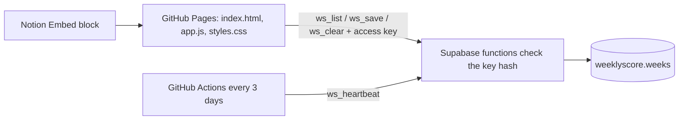

# Weekly Score

A small weekly review widget. Pick a week, tap a score from 1 to 10, and note what moved the needle and one change for next week. It is built to sit in a Notion Embed block, and it saves to Supabase so entries persist across weeks and devices.

## Use it in Notion

1. In the Notion page, type `/embed` and paste the link below with your access key in place of `YOUR_ACCESS_KEY`.

   ```
   https://evanmydude.github.io/weeklyscore/?k=YOUR_ACCESS_KEY
   ```

2. Drag the embed's bottom edge until the whole card shows (about 900 px).

The embed loads live data every time it opens and refreshes when you return to the tab. Code changes deploy to the same URL, so the embed never needs replacing. GitHub Pages can take up to 10 minutes to serve a new version.

Optional settings in the link:

- `&theme=light` or `&theme=dark` sets the starting theme. The toggle on the page overrides it on that device.
- If Notion ever drops the `?k=` part, use `#k=YOUR_ACCESS_KEY` instead.

If the page opens without a key, it shows an *Access key* box. Paste the key (or the whole link) and it unlocks; that browser or app remembers the key, so each device only needs it once. A remembered key that stops working, such as after a rotation, is forgotten and the box comes back.

If the embed sits inside a Notion button's template, edit the embed link in the template too, or every new week copies the old link.

Anyone who can see the Notion page can see the key in the embed link, so don't publish that page to the web.

## How it works



- The site is static HTML, CSS and JavaScript with no build step and no dependencies.
- Data lives in the Supabase project `weeklyscore` in the table `weeklyscore.weeks`, one row per ISO week (Monday to Sunday). That schema is not exposed through the Supabase Data API.
- The page reaches the data only through three Postgres functions (`ws_list`, `ws_save`, `ws_clear`). Each one compares the access key with a SHA-256 hash stored in `weeklyscore.access`, and refuses the request if it doesn't match.
- `ws_save` merges fields, so a field the request leaves out keeps its saved value. Two devices editing different fields of the same week don't overwrite each other.
- A score saves as soon as you tap it. Text saves 0.6 seconds after you stop typing, when you leave the box, and when the page is hidden. Failed saves retry with backoff, and the badge shows *Not saved, retrying* until they land.
- The publishable key in `app.js` is meant to be public. Without the access key, the only function it can use is `ws_heartbeat`.

The Supabase security advisor reports two findings that are intended here. *RLS Enabled No Policy* means no role can read the tables directly. *Public Can Execute SECURITY DEFINER Function* covers the `ws_*` functions, which check the access key themselves (`ws_heartbeat` only updates one timestamp).

To export everything, run this in the Supabase SQL editor and use its export button.

```sql
select week, score, moved_needle, one_change, updated_at
from weeklyscore.weeks
order by week;
```

## Keeping the free project awake

Supabase pauses free projects after about a week without database activity. The workflow in `.github/workflows/keepalive.yml` writes a heartbeat every 3 days, so a skipped week doesn't pause it. If the project has already been paused, the run fails and shows in the Actions tab.

GitHub turns off scheduled workflows after 60 days without a commit to the repository. If that happens, re-enable *Keep database awake* from the Actions tab. If the project does pause, the widget says it can't reach the database; restore the project from the Supabase dashboard and your data will be there.

## Rotating the access key

Generate a new key and its hash.

```bash
KEY=$(openssl rand -base64 32 | tr '+/' '-_' | tr -d '=\n'); echo "$KEY"; printf '%s' "$KEY" | sha256sum
```

Store the hash in the Supabase SQL editor, then update the embed link with the new key.

```sql
update weeklyscore.access set key_sha256 = '<64 hex characters>' where id;
```

## Setting it up from scratch

1. Create a Supabase project, run `supabase/schema.sql` in its SQL editor, then insert the hash of a new key with `insert into weeklyscore.access (key_sha256) values ('<hash>');`.
2. Put the project URL and publishable key in `app.js` and `.github/workflows/keepalive.yml`, and the project URL in the `connect-src` of the Content Security Policy in `index.html`.
3. Turn on GitHub Pages in Settings → Pages with *Deploy from a branch*, branch `main`, folder `/ (root)`.

## Development

Run the week math tests.

```bash
npm test
```

Serve the site locally, then open `http://localhost:8000/?k=YOUR_ACCESS_KEY`.

```bash
npm run serve
```
